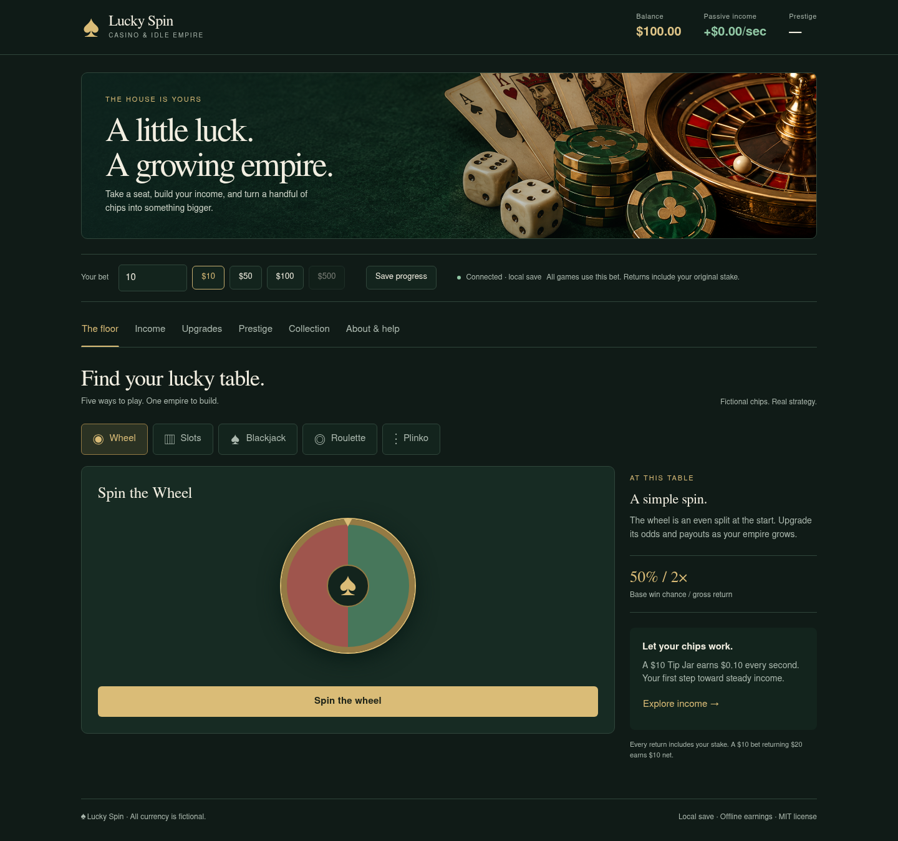

# Lucky Spin

A casino you can build. Five games, an idle economy, and a growing empire — in your terminal or browser, powered by the same C++ engine.

[](src/core)
[](#getting-started)
[](LICENSE)

All balances are fictional game currency. Playing needs no account, payment, or internet connection.

## Getting started

Requires Linux, a C++11 compiler, GNU Make, and Python 3 for embedding the artwork. No runtime dependencies beyond the system C++ libraries. A modern browser is needed for the GUI; a UTF-8 terminal is needed for the TUI.

```bash
git clone https://github.com/aurelioochoa/luckyspin.git
cd luckyspin
make build
make run                  # Terminal game
make gui                  # Browser game at http://127.0.0.1:8787
```

The HTML and generated artwork are embedded in the executable. You can move or install the binary without copying an asset folder.

```bash
./gambling_game --gui --no-open --port 8788
make install              # Installs ~/.local/bin/lucky-spin
lucky-spin --gui
```

The web server binds to localhost. If the requested port is busy, it tries the next 20 ports without exceeding 65535; the startup message prints the actual URL. Use `Ctrl+C` to stop it and save progress.

## Two ways to play

### Terminal

A compact dashboard shows bankroll, stake, income, prestige, and run statistics. Wide terminals get a two-column menu; smaller windows get a scrolling list that keeps your selection visible. Shops show details for the highlighted item and keep earning income while you browse.

```text
  ♠  LUCKY SPIN  /  casino & idle empire
  ────────────────────────────────────────────────────────────────────────
  BANKROLL  $100.00                     PASSIVE  +$0.00/s
  Bet $10.00  ·  Round 1                Prestige 0  ·  Stars 0
  Wins 0  /  Losses 0                   Peak $100.00
  Build your income. Upgrade your odds. Play your way.
  ────────────────────────────────────────────────────────────────────────
  THE FLOOR / SHOPS                     YOUR EMPIRE
  › 0  Spin the Wheel                   7  Change Bet
    1  Play Slots                      8  Prestige
    2  Blackjack                       9  Specialization
    3  Roulette                           Achievements
    4  Plinko                             About & help
    5  Generator Shop                     Save Game
    6  Upgrade Shop                       Restart Game
                                          Quit Game
  ────────────────────────────────────────────────────────────────────────
  Spin the Wheel (50% chance, 2.00x)
  ↑/↓ W/S move · Enter play · 0–9 jump
  V save · ? help · Q quit
```

| Control | Action |
| --- | --- |
| ↑ / ↓ or W / S | Move through choices |
| Enter, Space, or D | Select the highlighted choice |
| 0–9 | Run the numbered main-menu action |
| V | Save from the main menu |
| ? | Read paged rules and keyboard help |
| Q | Leave a submenu; quit and save from the main menu |
| E in Generator Shop | Cycle ×1 / ×10 / ×25 / ×100 / MAX |

`NO_COLOR=1 ./gambling_game` disables color styling. The game restores your terminal settings and cursor on exit or interruption.

### Browser

Select a table, set your stake, and play. Each table has a rule summary; results show both the gross return and net change. The interface includes bet validation, pending-action feedback, reconnect status, keyboard focus, reduced-motion support, and confirmations for resets.



Use **1–5** to select a table, **Tab** to move between controls, **Enter** to activate them, and **Esc** to close confirmations. Number shortcuts pause while typing. The interface adapts to mobile screens.

## Build your empire

Start with **$100**. A **$10 Tip Jar** earns **$0.10/s**, so buy one early to give yourself steady income between rounds.

| Game | Base rules |
| --- | --- |
| Wheel | 50% win chance; 2× return |
| Slots | Match three symbols; 5× return |
| Blackjack | Six-deck shoe; dealer stands at 17; 2× return, 2.5× for a winning natural; ties return the stake |
| Roulette | European 0–36 wheel; outside bets return 2×, straight numbers 35×; zero loses outside bets |
| Plinko | Three risk levels; edge returns of 2× / 6× / 35× |

Returns include the original stake: a $10 bet returning $20 earns $10 net. Upgrades, specializations, and events can increase returns.

- **11 generators** with bulk buying and ownership synergies.
- **12 upgrade lines** for odds, payouts, and passive income.
- **Five game specialties** with a 50% payout bonus; an all-rounder option with no bonus.
- **Nine achievements**, each adding a permanent 1% income bonus.
- **Prestige** starting at $100K earnings in the current run, with a requirement that doubles each level. Prestige adds 0.1 to your income multiplier and awards stars for four permanent perk lines.
- **Random events:** Happy Hour doubles passive income, Hot Streak increases payouts, and Money Rain grants an immediate bonus.

Prestige keeps achievements, stars, purchased perks, and your specialty. **Reset all progress** clears everything and starts again at $100.

## Saves and offline income

Both interfaces use the same save:

```text
${XDG_DATA_HOME:-~/.local/share}/luckyspin/lucky_spin_save.txt
```

Saves use a checksum, a temporary file, and a backup of the previous save. Legacy saves in the working directory migrate automatically. The terminal saves every 30 seconds, when buying or changing settings, and on normal quit. The browser saves after successful actions and every 30 seconds while polling; server shutdown saves too.

Offline earnings apply when you return, up to the cap determined by your upgrades and perks. Use one running game instance at a time. Finish blackjack hands before closing: the bankroll is saved, but an active hand is not restored.

## Development and verification

```bash
make                      # Show available commands
make test                 # Engine, rendering helpers, JSON, and HTTP regressions
make test-tui             # Real pseudo-terminal navigation and layout checks
make test-asan            # AddressSanitizer and UndefinedBehaviorSanitizer
make check                # Core tests and font diagnostics
```

Optional browser regressions require Node.js 20+ and Playwright:

```bash
npm install --no-save --package-lock=false playwright
npx playwright install chromium
make test-browser
```

The browser checks use a private temporary save and a localhost server. They cover all five games, bets, shops, specialties, reset/cancel, reconnecting, keyboard controls, reduced motion, and desktop/mobile layouts. `PLAYWRIGHT_MODULE` and `CHROMIUM_PATH` can point to an existing installation.

The frontend uses plain HTML, CSS, and JavaScript. The game remains a single C++ executable; Python and Playwright are build/development tools only.

## Documentation and contribution

- [Game design and economy](docs/GDD.md)
- [Gameplay roadmap](docs/GAMEPLAY_IMPROVEMENTS.md)
- [Generated artwork and prompt](docs/ARTWORK.md)

Bug reports and contributions are welcome. Include your interface, steps to reproduce, and expected behavior. Run the checks relevant to your change before submitting it.

Licensed under [MIT](LICENSE).
